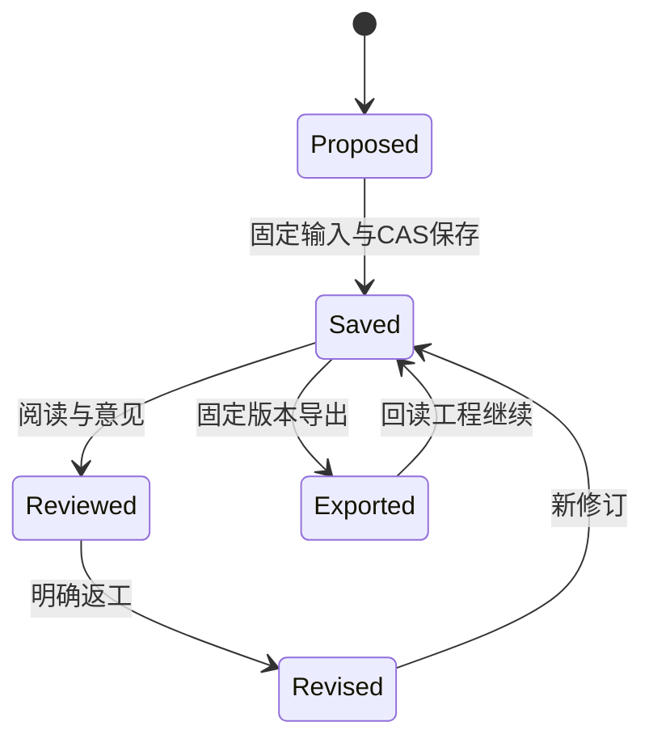

# 领域与本体设计

## 领域边界

正式正典归宿主；历史与经济判断归作者和外部Agent。本包只计算明确声明的虚构历法及整数资源，不推断真实地理、社会科学结论或自动修改正典。地图及行程投影复用小说图鉴，故事事件偏序复用小说规划。

| Owner | 拥有的事实 |
| --- | --- |
| 河图Core | WorkRef、固定来源、专业对象修订、CAS、原操作、正式正文及作者决定 |
| 本插件 | 专业结构、计算、专业偏好、视图与可再生成导出 |
| 外部Agent | 理解、规划、内容生成与方法执行 |
| 作者 | 取舍、采纳、定稿、内容外发和费用决定 |

## 核心本体

| 对象 | 存储集合 | 创作含义 |
| --- | --- | --- |
| calendar | calendars | 历法 |
| marker | markers | 纪年事件 |
| rule | rules | 制度规则 |
| resource | resources | 资源 |
| scenario | scenarios | 推演情景 |

所有局部ID只在当前专业工程中有意义；同名、同ID或相同版本号不能跨作品推定身份。引用正文时固定UTF-8字节区间与原引文；引用媒体时固定宿主素材修订和摘要。

## 关系与不变量

calendar 1—N marker；rule N—N premise；scenario N—N assumed rule；scenario 1—N event N—1 resource。

每个集合ID唯一，外键必须存在；删除仍被使用的对象拒绝保存。全对象更新与细粒度动作遵循同一校验，不存在绕过领域规则的编辑入口。来源更新先说明影响，再明确建立新修订。专业选中状态不扩大成宿主选用或作者定稿。

## 领域推断的证据边界

虚构月份、闰日、跨年、纪元边界和非法日期

规则环、传递依赖、假设与作者声明分别报告

整数资源、负余额、混合单位与安全整数溢出

修改规则后传递影响明确，旧情景和正典保持

空世界、部分阅读、多个独立作品、中文引文与CAS恢复

## 专业对象状态

此状态图描述工作旅程，不新增重复的数据库状态机。正文采纳与定稿由宿主另行处理。
