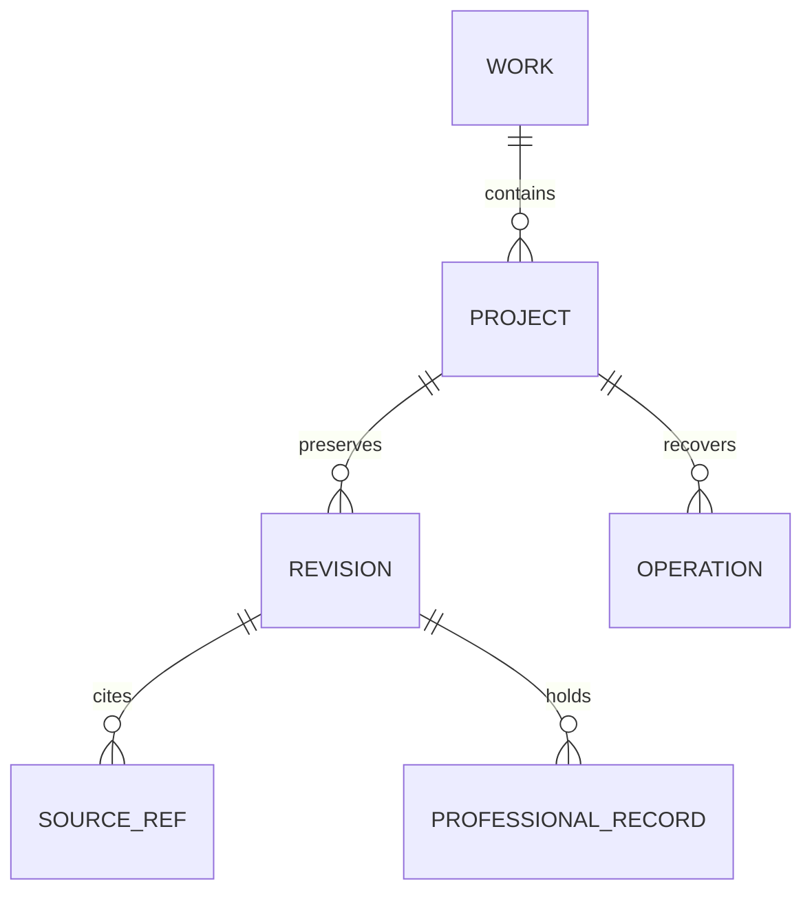
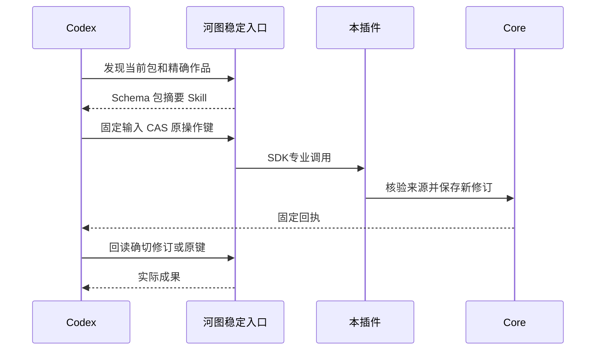

# 数据与API设计

## 数据格式

宿主包外壳按其Draft-07清单校验；专业数据与动作由Ajv2020独立校验，两者不混用。唯一可执行Schema是[包清单](../contracts/plugin-manifest.json)，`additionalProperties=false`拒绝拼错字段。`format_version=1`，Schema版本`1.0.0`；升级不得裁掉新字段覆盖旧数据。

| 根字段 | 类型 | 必填 |
| --- | --- | --- |
| format_version | constant | 是 |
| title | string | 是 |
| basis_refs | array | 是 |
| calendars | array | 是 |
| markers | array | 是 |
| rules | array | 是 |
| resources | array | 是 |
| scenarios | array | 是 |

### 历法 `calendars`

| 字段 | 类型／范围 |
| --- | --- |
| id | `{"type":"string","minLength":1,"maxLength":100}` |
| title | `{"type":"string","minLength":1,"maxLength":200}` |
| epoch_year | `{"type":"integer","minimum":0,"maximum":9999}` |
| months | `{"type":"array","items":{"type":"object","additionalProperties":false,"properties":{"name":{"type":"string","minLength":1,"maxLength":100},"days":{"type":"integer","minimum":1,"maximum":1000}},"required":["name","days"]},"maxItems":100}` |
| weekdays | `{"type":"array","items":{"type":"string","minLength":1,"maxLength":50},"maxItems":50}` |
| leap_every | `{"anyOf":[{"type":"integer","minimum":1,"maximum":1000},{"type":"null"}]}` |
| leap_month | `{"type":"integer","minimum":1,"maximum":100}` |
| leap_days | `{"type":"integer","minimum":1,"maximum":100}` |

### 纪年事件 `markers`

| 字段 | 类型／范围 |
| --- | --- |
| id | `{"type":"string","minLength":1,"maxLength":100}` |
| title | `{"type":"string","minLength":1,"maxLength":200}` |
| calendar_id | `{"type":"string","minLength":1,"maxLength":100}` |
| date | `{"type":"object","additionalProperties":false,"properties":{"year":{"type":"integer","minimum":0,"maximum":9999},"month":{"type":"integer","minimum":1,"maximum":100},"day":{"type":"integer","minimum":1,"maximum":1000}},"required":["year","month","day"]}` |
| ranges | `{"type":"array","items":{"type":"object","additionalProperties":false,"properties":{"source_index":{"type":"integer","minimum":0,"maximum":99},"byte_start":{"type":"integer","minimum":0,"maximum":100000000},"byte_end":{"type":"integer","minimum":0,"maximum":100000000},"quote":{"type":"string","minLength":0,"maxLength":16000}},"required":["source_index","byte_start","byte_end","quote"]},"maxItems":100}` |

### 制度规则 `rules`

| 字段 | 类型／范围 |
| --- | --- |
| id | `{"type":"string","minLength":1,"maxLength":100}` |
| title | `{"type":"string","minLength":1,"maxLength":200}` |
| premise_rule_ids | `{"type":"array","items":{"type":"string","minLength":1,"maxLength":100},"maxItems":100}` |
| statement | `{"type":"string","minLength":1,"maxLength":8000}` |
| status | `{"enum":["hypothesis","author_declared"]}` |
| ranges | `{"type":"array","items":{"type":"object","additionalProperties":false,"properties":{"source_index":{"type":"integer","minimum":0,"maximum":99},"byte_start":{"type":"integer","minimum":0,"maximum":100000000},"byte_end":{"type":"integer","minimum":0,"maximum":100000000},"quote":{"type":"string","minLength":0,"maxLength":16000}},"required":["source_index","byte_start","byte_end","quote"]},"maxItems":100}` |

### 资源 `resources`

| 字段 | 类型／范围 |
| --- | --- |
| id | `{"type":"string","minLength":1,"maxLength":100}` |
| name | `{"type":"string","minLength":1,"maxLength":200}` |
| unit | `{"type":"string","minLength":1,"maxLength":100}` |
| initial | `{"type":"integer","minimum":-1000000000,"maximum":1000000000}` |
| minimum | `{"anyOf":[{"type":"integer","minimum":-1000000000,"maximum":1000000000},{"type":"null"}]}` |

### 推演情景 `scenarios`

| 字段 | 类型／范围 |
| --- | --- |
| id | `{"type":"string","minLength":1,"maxLength":100}` |
| title | `{"type":"string","minLength":1,"maxLength":200}` |
| assumed_rule_ids | `{"type":"array","items":{"type":"string","minLength":1,"maxLength":100},"maxItems":100}` |
| events | `{"type":"array","items":{"type":"object","additionalProperties":false,"properties":{"id":{"type":"string","minLength":1,"maxLength":100},"resource_id":{"type":"string","minLength":1,"maxLength":100},"delta":{"type":"integer","minimum":-1000000000,"maximum":1000000000},"unit":{"type":"string","minLength":1,"maxLength":100},"reason":{"type":"string","minLength":1,"maxLength":2000}},"required":["id","resource_id","delta","unit","reason"]},"maxItems":500}` |

## 数据库与持久化

本包不新增SQLite或第二个作品数据库。使用公开SDK的ProjectStore保存`world_studio`专业对象。宿主保存不可变修订，插件只提交内容和固定来源。

| 逻辑记录 | 主键／关系 | 维护Owner |
| --- | --- | --- |
| 专业对象 | WorkRef＋Owner＋object_id | Core |
| 专业修订 | object_id＋revision，sha256，previous_sha256 | Core |
| 操作回执 | 工作区＋Owner＋operation_key | Core |
| 专业内容 | 上述根对象及集合局部ID | 本包 |
| 来源／专业依据 | 固定WorkRef、修订与摘要 | 原Owner |

## 公开API

Codex先调用河图实际能力发现，再用`hetu.plugins.capabilities`取得本包Schema和摘要，最终通过`hetu.plugins.invoke`调用。绑定精确WorkRef、management_ref、plugin_id、package_sha256及capabilities_sha256；不将路径或标题当身份。

| 动作 | 用途 | 效果 |
| --- | --- | --- |
| list_projects | 查找专业工程 | read |
| get_project | 读取固定专业工程 | read |
| save_project | 保存专业工程 | managed_write |
| put_calendar | 维护历法 | managed_write |
| remove_calendar | 移除历法 | managed_write |
| put_marker | 维护纪年事件 | managed_write |
| remove_marker | 移除纪年事件 | managed_write |
| put_rule | 维护制度规则 | managed_write |
| remove_rule | 移除制度规则 | managed_write |
| put_resource | 维护资源 | managed_write |
| remove_resource | 移除资源 | managed_write |
| put_scenario | 维护推演情景 | managed_write |
| remove_scenario | 移除推演情景 | managed_write |
| convert_date | 换算虚构日期 | read |
| compare_dates | 比较同一历法日期 | read |
| check_rules | 检查规则依赖与假设 | read |
| simulate_resources | 推演资源收支 | read |
| preview_impact | 预览规则修改影响 | read |
| get_source | 读取固定来源 | read |
| get_basis | 读取固定专业依据 | read |
| compare_versions | 比较固定修订 | read |
| export_project | 导出固定专业报告 | read |
| build_context | 准备有界创作上下文 | read |
| create_handoff | 准备精确AI交接 | read |
| get_operation | 回读原操作 | read |

逐字段参数归清单，生成的[功能清单](../CAPABILITIES.md)和[方法操作地图](../skills/hetu-world-studio/references/operations.md)提供导航。

## 写入与错误

新建使用expected_revision=0和空expected_sha256；更新使用回读的确切修订和摘要，所有写入携带原operation_key。同键同输入回读原成果，同键不同输入拒绝；冲突保留输入。错误包括invalid_input、revision_conflict、idempotency_conflict、not_found和hetu.budget_exceeded，以实际宿主回执为准。

导出按固定对象分块，核对offset、总长度、分块与完整SHA-256。UTF-8分块不能切断字符，二进制不经字符串转码。
